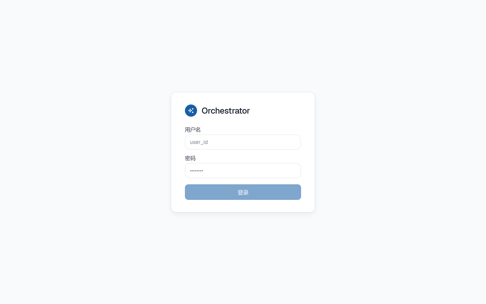
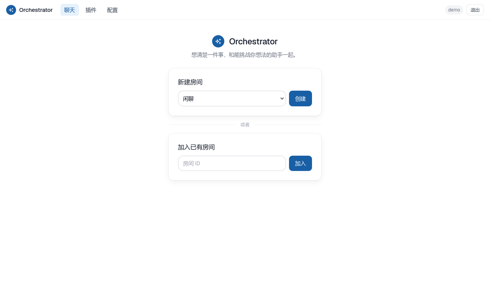
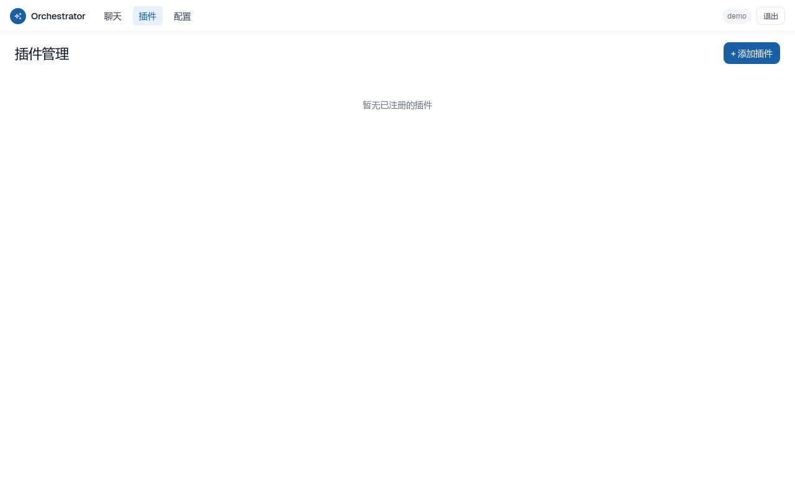
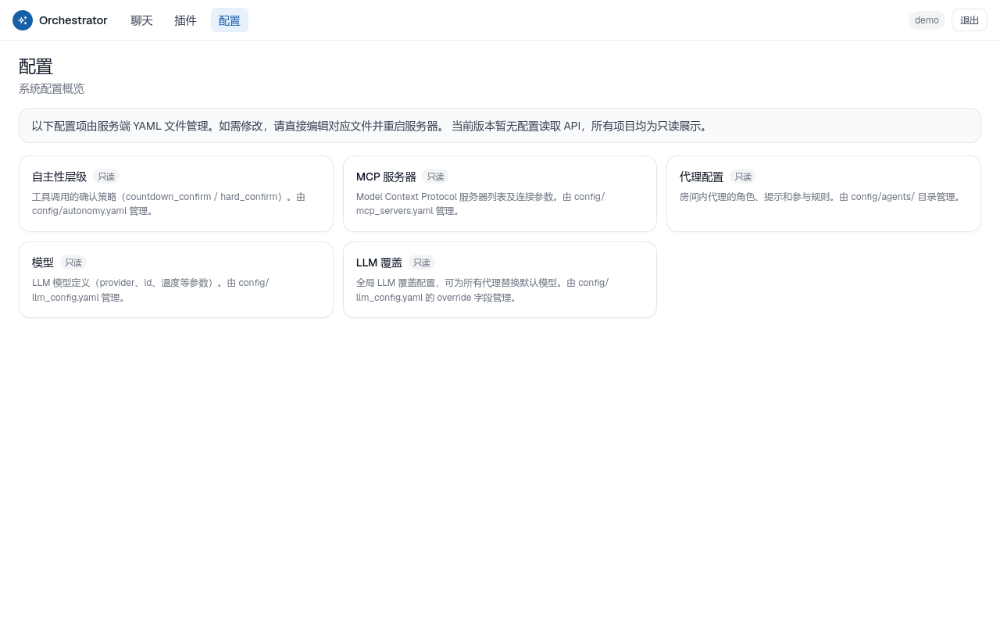

**[English](README.md) | 中文**

# Orchestrator

**AI 研究与决策助手 — 诚实的对话者，而非听话的执行者。**

Orchestrator 是一个多智能体（multi-agent）对话平台，专为希望深入思考而非仅求答案的独立开发者而设计。系统中的 agent 会提出反驳、追问问题、揭示分歧 — 它们不替你做决定，但会帮你磨砺自己的判断。

助手 room（对话间）由多智能体编排器（multi-agent orchestrator）、仅追加事件流（append-only event stream）、自主权门控系统（AUTO / COUNTDOWN / HARD-confirm）、沙箱插件体系及多用户认证共同支撑。

---

## 功能特性

- **多智能体 room** — 每个 room 运行一组可配置的 agent（facilitator、skeptic、investigator、planner 等），这些 agent 通过事件流响应用户消息并相互交互
- **自主权门控（Autonomy gate）** — 每次工具调用均按风险评分分类；低风险操作自动触发（AUTO），中风险操作启动倒计时可中途取消（COUNTDOWN），高风险操作需显式确认（HARD）
- **事件溯源历史** — 所有 room 活动均记录为仅追加事件日志；快照（snapshot）是派生产物，从不作为权威来源
- **沙箱插件** — plugin 在系统调用白名单下运行（seccomp / landlock）；plugin 注册表与生命周期管理端点可通过 GUI 或 REST API 操作
- **三层 LLM 配置** — provider / 模型 / 单 agent 配置相互独立；从 DeepSeek 切换到本地 Ollama 无需修改 agent 定义
- **MCP 支持** — 通过模型上下文协议（Model Context Protocol）接入外部工具（文件系统、数据库、远程服务等）
- **多用户认证** — 基于 session cookie 的认证，默认关闭（fail-closed，无未认证访问），每线程独立的 WAL reader pool
- **GUI** — React 前端，含聊天视图、插件管理（E2）及配置总览（E3）

---

## 安装

### 环境要求

- Python ≥ 3.12 及 [uv](https://docs.astral.sh/uv/)
- Node.js ≥ 24（仅前端需要）

### 后端

```bash
# 安装 Python 依赖（运行服务器需要 api + mcp 额外依赖）
uv sync --extra api --extra mcp

# 复制并填写配置模板
for f in config/*.example; do cp "$f" "${f%.example}"; done
# 然后编辑 config/llm_providers.yaml 和 config/llm_models.yaml
# 填入你的 LLM provider 信息，详见各文件中的注释。
```

需要填写凭据 / 端点的配置文件：

| 文件 | 用途 |
|---|---|
| `config/llm_providers.yaml` | LLM provider 连接配置（DeepSeek、Ollama、Claude Code CLI 等） |
| `config/llm_models.yaml` | 模型配置（provider、能力、上下文窗口） |
| `config/llm_override.yaml` | 可选：全局模型覆盖，应用于所有 agent |
| `config/email.yaml` | 可选：邮件工具 |
| `config/web_search.yaml` | 可选：网络搜索工具 |

### 前端

```bash
cd ui && npm install
```

---

## 运行

### 1. 创建首个用户

认证默认关闭（fail-closed） — 服务器在没有至少一个用户的情况下不会绑定远程地址，且不提供未认证的注册端点。使用以下命令初始化第一个账户：

```bash
# 交互式（提示输入密码）：
uv run python -m orchestrator.api.admin create-user <your-username>

# 非交互式（例如在脚本中使用）：
ORCHESTRATOR_ADMIN_PASSWORD=<password> uv run python -m orchestrator.api.admin create-user <your-username>
```

### 2. 启动后端

```bash
uv run python -m orchestrator.api --config config/ --db data/rooms.db
# 默认绑定到 127.0.0.1:8000
# 使用 --host / --port 更改地址。非回环（non-loopback）绑定需在代理层配置 TLS。
```

### 3. 启动前端

```bash
cd ui && npm run dev
# Vite 开发服务器运行在 http://localhost:5173
# 代理 /rooms /events /plugins /login /logout → :8000
```

打开 `http://localhost:5173`，登录，创建一个 room，开始思考。

---

## 截图

### 登录页



### 大厅 — 创建或加入 room



### 插件管理



### 配置总览



---

## 设计与开发文档

- [`handoff.md`](handoff.md) — 架构、设计原则、ADR 索引
- [`docs/architecture/`](docs/architecture/) — ADR 文档（ADR-001..040）
- [`docs/decisions/`](docs/decisions/) — ADR 完整正文

---

## 重新生成截图

```bash
# 前提：后端与前端均在运行，且已创建 "demo" 用户
LD_LIBRARY_PATH=/tmp node docs/screenshot.mjs
# （LD_LIBRARY_PATH 仅在系统缺少 libasound2 时需要此绕过方案）
```
